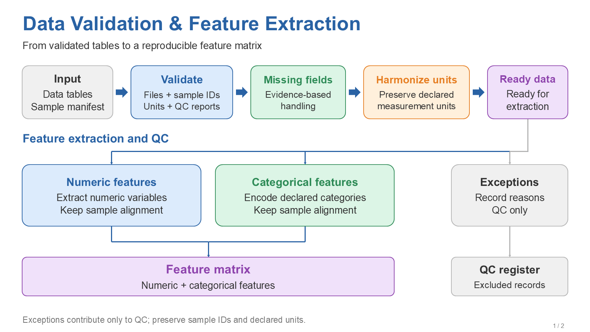
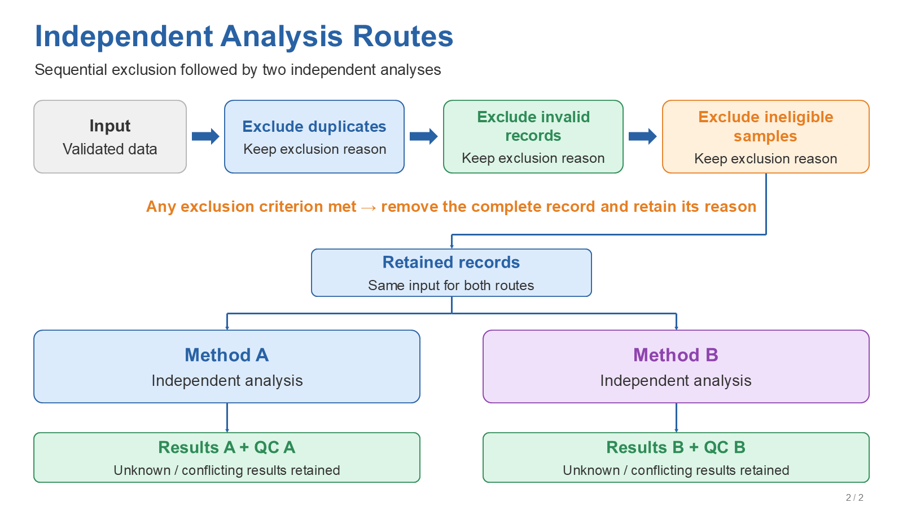

# Editable PPT Flowcharts Skill

输入一段方法，输出简洁、可修改的 PowerPoint 流程图。适合研究方法、特征提取、数据分析和业务流程，也支持依据提供的 PPT 匹配字体和版式。

本 skill 将“理解方法”和“可靠制图”分开：Codex 把自然语言转换为节点与连线方案，Python helper 生成原生 PPT 对象，PowerPoint helper 渲染并检查文本边界。用户无需准备 JSON。

## 样式与输出

- 16:9 白底，Arial，蓝色标题，蓝/绿/橙/紫浅色圆角框，灰色输入及辅助分支。
- 顺序流程、类别分支、独立检测路线和 QC 输出分别表达，保留单位、阈值、版本与计数条件。
- 文本、框和箭头均为可编辑的 PowerPoint 对象。连接线为可编辑的路径段；拖动节点后可能需要重新调整线的位置。
- 默认交付 PPTX 和 PNG 预览；参考 PPT 的字体和风格优先于默认值。




[下载两页可编辑示例](examples/demo.pptx) · [示例方法](examples/method.md) · [中间布局](examples/layout.json)

## 使用

把 `skills/editable-ppt-flowcharts` 整个目录复制到你的 Codex skill 目录。保留里面的脚本和 references，不要只复制 SKILL.md。

依赖安装：

```text
python -m pip install -r skills/editable-ppt-flowcharts/requirements.txt
```

调用示例：

```text
使用 $editable-ppt-flowcharts，将下面的方法做成两页可编辑 PPT。
字体 Arial，文案英文；顺序、独立分支和 QC 条件必须保留。
[粘贴方法；可附参考 PPT]
```

没有显式语言要求时保留输入语言；中文可使用模板中的中文字体或 Microsoft YaHei。没有模板也可直接使用默认样式。

此仓库使用标准的 `SKILL.md` 指令与脚本目录结构，参考 [OpenAI 的 skill 说明](https://developers.openai.com/blog/eval-skills)。

## 复现示例与验证

从仓库根目录执行：

```text
python skills/editable-ppt-flowcharts/scripts/build_ppt.py examples/layout.json work/demo.pptx
python skills/editable-ppt-flowcharts/scripts/validate_ppt.py work/demo.pptx --spec examples/layout.json
powershell -NoProfile -ExecutionPolicy Bypass -File skills/editable-ppt-flowcharts/scripts/render_powerpoint.ps1 -Pptx work/demo.pptx -OutputDir work/previews
python skills/editable-ppt-flowcharts/scripts/validate_ppt.py work/demo.pptx --spec examples/layout.json --render-report work/previews/render_report.json
```

结构检查核对原生对象、正文完整性和画幅边界；带 `--spec` 时还核对显式字体、每段连线的起终点与箭头方向。渲染检查需要 Windows 与已安装的 Microsoft PowerPoint，会输出每页 PNG 和文本边界报告；脚本不会关闭用户已有的其他演示文稿。

未使用渲染引擎时只能报告结构检查通过，不能宣称已排除文字溢出。PNG 仍需人工查看以发现视觉遮挡或连线误义。示例展示制图结果，不表示方法已经执行或获得科学验证。

公开包仅包含新建的 skill、通用示例和原生生成/验证脚本，不包含源模板的项目内容或隐藏旧页面。脚本运行无需 OpenAI API key，也不会自动上传方法或发布文件。
